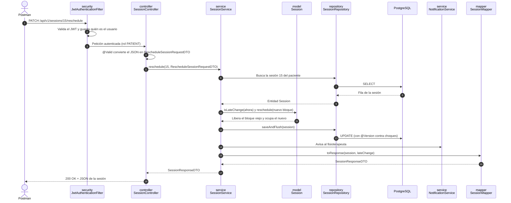

# FisioVital Web Services

API RESTful de FisioVital, construida con Spring Boot 3.5, Java 21, Spring Data JPA, Spring Security + JWT,
PostgreSQL, Spring AI (Google Gemini) y Swagger (OpenAPI). Cubre las **20 User Stories** del informe (US01 a US20).

> Para instalarlo en otra PC, sigue en orden las secciones **Requisitos**, **0. Configurar variables locales**,
> **1. Crear la base de datos** y **2. Abrir y ejecutar en IntelliJ IDEA**.

## Qué incluye

- **20 historias de usuario** (US01–US20), cada una con sus escenarios exitoso, de error y alternativo.
- **Arquitectura en capas** Controller → Service → Repository, con DTOs (`*RequestDTO` / `*ResponseDTO`) y
  mappers de MapStruct. La API nunca devuelve entidades (ver [Arquitectura en capas](#arquitectura-en-capas)).
- **Asistente con IA (US17–US20)** con Spring AI y Google Gemini: resuelve dudas, recomienda especialistas y
  reserva o reprograma sesiones conversando, reutilizando las mismas reglas de negocio.
- **Recordatorio automático (US13)** 24 horas antes de cada sesión, por correo (Gmail) y como notificación.
- Seguridad con **JWT y roles** (paciente / fisioterapeuta), mensajes en **dos idiomas** (es-419 / en-US según
  `Accept-Language`), control de concurrencia con `@Version` y errores siempre con su código HTTP correcto.
- **85 tests de integración** en verde y una **colección de Postman** con 71 aserciones (ver [Pruebas](#pruebas)).

## Documentación

| Documento | Contenido |
|---|---|
| [`docs/RESULTADO_SPRINT1.md`](docs/RESULTADO_SPRINT1.md) | Resultado del Sprint 1: estado de cada US, tests que la cubren y tabla real de endpoints |
| [C4 · Nivel 1 — Contexto](docs/diagrams/c4-1-contexto.md) | Paciente, fisioterapeuta, FisioVital y los sistemas externos (SMTP, Gemini) |
| [C4 · Nivel 2 — Contenedores](docs/diagrams/c4-2-contenedores.md) | Web App (Angular), Web Services (Spring Boot) y PostgreSQL |
| [C4 · Nivel 3 — Componentes](docs/diagrams/c4-3-componentes.md) | Capas controller → service (+ mapper) → repository de cada módulo |
| [C4 · Nivel 4 — Código](docs/diagrams/c4-4-codigo.md) | Clases que implementan reprogramar y cancelar una sesión (US11–US12) |
| [`CHANGELOG.md`](CHANGELOG.md) | Cambios de cada versión |
| Swagger | `http://localhost:8080/swagger-ui.html` con la app levantada: todos los endpoints con ejemplos |

Los diagramas están en Mermaid, así que GitHub los dibuja directamente al abrir cada archivo.

## Correcciones de la retroalimentación (TB2)

| # | Observación | Qué se hizo |
|---|---|---|
| — | Arquitectura organizada por bounded contexts (DDD) en lugar de capas | Reorganizada en capas Controller → Service → Repository, una carpeta por capa, con DTOs y MapStruct; los tests siguen la misma estructura |
| 5 | US04 sin el mensaje "No hay especialistas disponibles" | La búsqueda responde `{items, message}` con el mensaje i18n cuando no hay resultados |
| 5 | US05 sin el mensaje "Sin disponibilidad por ahora" | El perfil incluye `availabilityMessage` cuando no hay horarios |
| 5 | US14 sin manejo de carga > 2 min (T23 marcada Done sin implementar) | Historial paginado y timeout configurable (`QUERY_TIMEOUT_MS`) que responde 503 con "Por favor inténtalo más tarde", como pide el informe; probado con test |
| 6 | Endpoints de notas clínicas y progreso responden 500 | Se eliminaron las notas clínicas y el progreso; las rutas inexistentes responden 404, nunca 500 |
| — | Errores de usuario que caían en 500 | `GlobalExceptionHandler` mapea 400, 401, 403, 404, 405, 409, 422, 423 y 503 |
| 1 | Falta el diagrama de Componentes; `ClinicalNote` en los diagramas | Modelo C4 completo (4 niveles) sin `ClinicalNote`, con trazabilidad a las US |
| 6 | Tabla 8 no coincide con el código | Tabla real de endpoints en `docs/RESULTADO_SPRINT1.md` |
| — | Rutas de US14–US16 distintas al plan | Ahora `GET /api/v1/appointments/me` y `GET /api/v1/appointments/physiotherapist/me?patientName=` |
| — | Controller con lógica de negocio | Toda la lógica está en `service/`; los controllers solo reciben el DTO y delegan |
| 7 | No hay release v1.0.0 | Versiones registradas en `CHANGELOG.md` para publicar el release `v1.0.0` |

## Requisitos

- JDK 21 o superior (probado con 21 y 25). Maven **no** hace falta: el proyecto trae Maven Wrapper (`mvnw`)
- IntelliJ IDEA (Community o Ultimate)
- PostgreSQL 14 o superior (instalado localmente o con Docker)
- Postman
- Una cuenta de Google **personal** para:
  - la API key **gratuita** de Gemini (asistente, US17–US20);
  - la contraseña de aplicación de Gmail (recordatorios por correo, US13).

  Sin estas credenciales la aplicación arranca igual: el asistente responde 503 "El asistente no está disponible"
  (salvo sus respuestas de seguridad) y los recordatorios quedan solo como notificación en la plataforma.

## 0. Configurar variables locales (`.env`)

1. Copia `.env.example` como `.env` en la misma carpeta que `pom.xml`.
2. Completa las variables (ver las dos secciones siguientes). Spring lo lee solo al iniciar
   (`spring.config.import=optional:file:.env[.properties]`), y Docker Compose también.

```properties
GEMINI_API_KEY=tu-api-key-de-gemini
GEMINI_MODEL=gemini-3.5-flash-lite
MAIL_USERNAME=tu.correo@gmail.com
MAIL_PASSWORD=abcdefghijklmnop
```

> ⚠️ `.env` **nunca** se sube a GitHub. Como el `.gitignore` del equipo es local y no está en el repositorio,
> cada integrante debe crear el suyo al clonar, con al menos estas líneas, **antes** de hacer `git add`:
>
> ```
> .env
> target/
> .idea/
> ```
>
> Revisa siempre con `git status` que `.env` no aparezca antes de hacer commit.

## API key de Gemini (gratis) — asistente US17–US20

1. Entra a **https://aistudio.google.com/apikey** con una cuenta de Google **personal**
   (las cuentas institucionales a veces tienen AI Studio bloqueado).
2. Acepta los términos de Google AI Studio.
3. Pulsa **Create API key** y elige o crea un proyecto de Google Cloud.
4. Copia la key y pégala en `.env`: `GEMINI_API_KEY=tu-key`.

**Para que sea gratis y nunca te cobren:**

- **No** pulses *Set up billing* / *Upgrade* ni asocies una tarjeta. Sin una cuenta de facturación, la key queda en el
  **free tier**: si se agota la cuota, la API responde `429` y el asistente muestra "El asistente no está disponible"
  hasta que la cuota se renueve, pero **no cobra**.
- En la lista de keys de AI Studio, el proyecto debe figurar en el plan gratuito (*Free*).
- En el plan gratuito, Google puede usar el contenido para mejorar sus productos: usa **solo datos ficticios**,
  nunca datos reales de pacientes.
- Opcional: en Google Cloud Console → *APIs y servicios* → *Credenciales*, restringe la key a la
  *Generative Language API*.
- Al terminar el curso, borra la key desde AI Studio.

**Qué modelo usar:** por defecto `gemini-3.5-flash-lite`. Cada modelo tiene su propia cuota gratuita; por ejemplo,
`gemini-3.6-flash` solo permite **5 peticiones por minuto y 20 por día**, y una conversación de reserva usa entre
4 y 6 peticiones (cada herramienta que llama el modelo cuenta). Flash-Lite soporta las herramientas (tool calling)
y tiene una cuota mayor. Revisa tus límites en AI Studio → *Usage*. Si un modelo responde 404 (Google retira
modelos para cuentas nuevas), elige otro *Flash-Lite* o *Flash* de la lista:

```bash
curl -H "x-goog-api-key: TU_KEY" https://generativelanguage.googleapis.com/v1beta/models
```

## Correo de recordatorios (Gmail) — US13

El recordatorio se envía 24 horas antes de cada sesión, por correo y como notificación en la plataforma. Gmail no
acepta tu contraseña normal desde aplicaciones: necesitas una **contraseña de aplicación**. **No hace falta Google
Cloud ni pagar nada.**

1. Activa la **verificación en dos pasos** de tu cuenta de Google: https://myaccount.google.com/signinoptions/two-step-verification
   (es obligatoria para crear contraseñas de aplicación).
2. Entra a **https://myaccount.google.com/apppasswords**.
3. Escribe un nombre (por ejemplo, `FisioVital`) y pulsa **Crear**.
4. Google muestra una contraseña de **16 letras** (`abcd efgh ijkl mnop`). Cópiala **sin espacios** en `.env`:

   ```properties
   MAIL_USERNAME=tu.correo@gmail.com
   MAIL_PASSWORD=abcdefghijklmnop
   ```

5. Reinicia la aplicación. Los recordatorios salen desde `MAIL_USERNAME` (cámbialo con `MAIL_FROM` si quieres).

Si el envío falla (credenciales mal copiadas, sin internet), la sesión **igual** queda notificada en la plataforma
(`GET /api/v1/notifications`): es el escenario de error de US13. Al terminar el curso, revoca la contraseña de
aplicación desde la misma página.

## 1. Crear la base de datos

**Opción A — PostgreSQL instalado (pgAdmin):** crea una base de datos llamada `fisiovital`.
El usuario por defecto es `postgres` con contraseña `postgres`. Si tu contraseña es otra, cámbiala en
`src/main/resources/application.properties` (`spring.datasource.password`) o define la variable de entorno `DB_PASSWORD`.

**Opción B — Docker:**

```bash
docker compose up -d postgres
```

Las tablas se crean solas al iniciar la aplicación (`spring.jpa.hibernate.ddl-auto=update`).

## 2. Abrir y ejecutar en IntelliJ IDEA

1. *File → Open* y selecciona la carpeta `fisiovital-web-services` (la que contiene `pom.xml`).
2. Espera a que IntelliJ descargue las dependencias de Maven (barra inferior).
3. Verifica el JDK: *File → Project Structure → Project SDK = 21* (o superior).
4. Si IntelliJ lo sugiere, habilita *Annotation Processing* (necesario para Lombok).
5. Ejecuta `FisioVitalApplication` (botón ▶ junto al método `main`).
6. La API queda en `http://localhost:8080` y la documentación en **http://localhost:8080/swagger-ui.html**.

Desde la terminal, sin instalar Maven (la primera vez descarga Maven 3.9.16 solo):

```bash
./mvnw test              # Windows: mvnw.cmd test
./mvnw spring-boot:run   # Windows: mvnw.cmd spring-boot:run
```

## Pruebas

```bash
./mvnw test   # Windows: mvnw.cmd test  → 85 tests, 0 fallos
```

Son tests de integración: levantan la aplicación completa con una base H2 en modo PostgreSQL y llaman a los
endpoints con MockMvc, así que prueban de punta a punta controller, service, mapper, repository, seguridad y
mensajes i18n. No necesitan `.env` ni PostgreSQL, y Gemini se simula. Cada escenario comprueba el **código HTTP**
y, en los casos de error y alternativos, el **mensaje traducido**. `src/test` sigue la misma estructura en capas que
`src/main`:

| Test | Historias | Tests |
|---|---|---|
| `controller/AuthControllerTest` | US01–US03 | 10 |
| `controller/PhysiotherapistControllerTest` | US04–US05 | 8 |
| `controller/AvailabilityControllerTest` | US06–US07 | 6 |
| `controller/AgendaControllerTest` | US08 | 3 |
| `controller/TreatmentPlanControllerTest` | US09–US10, CRUD del plan, choque de horario y frecuencia semanal | 18 |
| `controller/SessionControllerTest` | US11–US12 (incluye choque de horario y frecuencia al reprogramar) | 9 |
| `controller/NotificationControllerTest` | US13 | 5 |
| `controller/AppointmentHistoryControllerTest` | US14–US16 | 9 |
| `controller/ClinicalNoteControllerTest` | Historia clínica (notas del fisioterapeuta y evolución por sesión) | 13 |
| `controller/AssistantControllerTest` y `AssistantControllerWithoutKeyTest` | US17–US20 | 17 |
| `exception/GlobalExceptionHandlerTest` | Errores 404/405/503 (incluye el 503 de US14) | 3 |
| `SmokeTest` | Arranque, seguridad, CORS (preflight) y creación del esquema de la BD | 4 |

## 3. Probar con Postman

1. *Import* → selecciona `postman/FisioVital.postman_collection.json`.
2. Abre la colección → *Run* (Collection Runner) → *Run FisioVital API - Sprint 1*.
3. Las peticiones se ejecutan en orden y guardan solas los tokens y los IDs (paciente, fisioterapeuta, bloques, plan, sesión).
4. Cada corrida genera usuarios nuevos, así que puedes repetirla las veces que quieras.

Para cambiar el idioma de las respuestas, cambia la variable `lang` a `en-US` (por defecto `es-419`).

La carpeta **08 Asistente IA (US17–US20)** necesita `GEMINI_API_KEY` y conversa con Gemini real. Sus escenarios
se validan con lo que queda en la agenda del fisioterapeuta (qué bloque se reservó o se movió), no con el texto
exacto de la respuesta. Antes de cada mensaje espera `aiDelayMs` (20 s) para no superar las 15 peticiones por
minuto del plan gratuito, por eso la corrida completa tarda unos 4 minutos. Con una key de pago puedes poner
`aiDelayMs` en `0` en las variables de la colección.

## 4. Datos de demostración (para la Web App)

Con el backend corriendo, `scripts/seed-demo.ps1` crea 3 fisioterapeutas y 4 pacientes. También publica sus horarios
para los próximos 14 días y reserva citas con planes de tratamiento, una cancelada y una reprogramada:

```bash
powershell -ExecutionPolicy Bypass -File scripts\seed-demo.ps1
```

Usa la API real, así que las citas quedan en fechas futuras y pasan a `COMPLETED` cuando llega su hora. Se puede
ejecutar de nuevo sin duplicar nada. Las cuentas, la contraseña y los diagnósticos están al inicio del script; los
correos son `@example.com`, así que los recordatorios por Gmail no le llegan a nadie real.

**Historia clínica de demostración.** La API no permite crear horarios en el pasado, así que la historia (sesiones
de las semanas pasadas con su nota de evolución, más una nota de antecedentes por paciente) se carga con SQL.
Primero arranca el backend una vez (crea `clinical_notes`) y corre `seed-demo.ps1`; luego:

```bash
psql -h localhost -U postgres -d fisiovital -f scripts/seed-history.sql
```

Agrega 14 sesiones pasadas con nota a los 5 planes demo y renumera las citas futuras. Si ya se cargó, no hace nada.

## Endpoints

| US | Método | Endpoint | Rol |
|---|---|---|---|
| US01 | POST | `/api/v1/auth/sign-up/patient` | Público |
| US02 | POST | `/api/v1/auth/sign-up/physiotherapist` | Público |
| US03 | POST | `/api/v1/auth/sign-in` | Público |
| US04 | GET | `/api/v1/physiotherapists?specialty=DEPORTIVA` | Autenticado |
| US05 | GET | `/api/v1/physiotherapists/{id}` | Autenticado |
| US06 | GET | `/api/v1/physiotherapists/{id}/slots?from=&to=` | Autenticado |
| US07 | POST | `/api/v1/physiotherapists/me/slots` | Fisioterapeuta |
| US08 | GET | `/api/v1/physiotherapists/me/agenda?date=` | Fisioterapeuta |
| US09 | POST | `/api/v1/treatment-plans` | Paciente |
| — | GET | `/api/v1/treatment-plans/me` | Paciente |
| — | GET | `/api/v1/treatment-plans/{planId}` | Paciente |
| — | PUT | `/api/v1/treatment-plans/{planId}` | Paciente |
| — | DELETE | `/api/v1/treatment-plans/{planId}` | Paciente |
| US10 | POST | `/api/v1/treatment-plans/{planId}/sessions` | Paciente |
| US11 | PATCH | `/api/v1/sessions/{sessionId}/reschedule` | Paciente |
| US12 | PATCH | `/api/v1/sessions/{sessionId}/cancel` | Paciente |
| US13 | GET | `/api/v1/notifications` | Autenticado |
| — | PATCH | `/api/v1/notifications/{id}/read` | Autenticado |
| US14 | GET | `/api/v1/appointments/me?page=0&size=20` | Paciente |
| US15 | GET | `/api/v1/appointments/physiotherapist/me` | Fisioterapeuta |
| US16 | GET | `/api/v1/appointments/physiotherapist/me?patientName=` | Fisioterapeuta |
| Historia clínica | GET / POST | `/api/v1/patients/{patientId}/clinical-notes` `{sessionId?, text}` | Fisioterapeuta que trata al paciente |
| US17–US20 | POST | `/api/v1/assistant/messages` `{conversationId?, message}` | Autenticado (reservar y reprogramar: Paciente) |

Especialidades válidas: `DEPORTIVA`, `COLUMNA_POSTURA`, `GERIATRICA`, `PEDIATRICA`, `POSTQUIRURGICA`, `NEUROLOGICA`.

## Arquitectura en capas

Arquitectura en capas clásica de Spring Boot: **Controller → Service → Repository**, más el patrón **DTO** con
mappers de **MapStruct**. Hay una sola carpeta por capa:

```
com.healthdev.fisiovital
├── controller/   @RestController: recibe el RequestDTO (@Valid) y delega en el service
├── service/      Lógica de negocio y @Transactional: RequestDTO → Entity y Entity → ResponseDTO
├── mapper/       Interfaces @Mapper de MapStruct (la implementación se genera al compilar)
├── repository/   Interfaces JpaRepository (Query Methods y JPQL con @Query)
├── model/        Entidades @Entity (tablas) y enums, con sus reglas de negocio
├── dto/
│   ├── request/  Records *RequestDTO: el JSON que entra (con @Valid)
│   └── response/ Records *ResponseDTO: el JSON que sale hacia el front
├── security/     Spring Security y JWT (SecurityConfig, JwtService, JwtAuthenticationFilter)
├── config/       i18n, Swagger, CORS (CorsConfig) y el cliente de Gemini
└── exception/    BusinessException y GlobalExceptionHandler
```

Los módulos del negocio se reconocen por el nombre de la clase: `Auth*` (US01–US03), `Physiotherapist*` /
`Patient*` (US04–US05), `Availability*` / `Slot*` (US06–US07), `TreatmentPlan*` / `Session*` / `Agenda*`
(US08–US12), `Notification*` / `ReminderScheduler` (US13), `Appointment*` (US14–US16) y `Assistant*` (US17–US20).

| Capa | Qué hace | Recibe → entrega |
|---|---|---|
| `controller/` | Expone la ruta HTTP, valida el JSON (`@Valid`) y llama al service. **Sin lógica** | Petición HTTP → `*ResponseDTO` con su código HTTP |
| `dto/request/` y `dto/response/` | Records `*RequestDTO` (JSON que entra) y `*ResponseDTO` (JSON que sale). Nunca se expone una entidad | — |
| `service/` | Lógica del caso de uso: quién es el usuario, qué entidades usar, transacción (`@Transactional`) | `*RequestDTO` → `*ResponseDTO` o `BusinessException` |
| `mapper/` | `@Mapper` de MapStruct: convierte Entity ↔ DTO sin escribir el mapeo campo por campo | Entity ↔ DTO |
| `model/` | Entidades JPA **con sus reglas** (por ejemplo `Session.isLateChange`, `AvailabilitySlot.isFree`) | — |
| `repository/` | Interfaces `JpaRepository`: Query Methods (`findByEmail`) y JPQL (`@Query`) | Ids / filtros → entidades |
| `exception/` | `BusinessException` y `GlobalExceptionHandler` (responde con `ErrorResponseDTO`) | Excepción → JSON de error traducido |

Reglas del proyecto: cada capa solo habla con la siguiente (un controller nunca usa un repositorio) y la API nunca
devuelve una entidad, siempre un `*ResponseDTO` construido por su mapper.

### Recorrido de una petición

Ejemplo real: el paciente reprograma su sesión (US11) desde Postman con
`PATCH /api/v1/sessions/15/reschedule`, `Authorization: Bearer <token>`, `Accept-Language: es-419` y el cuerpo
`{"newSlotId": 42}`.



Si algo falla en el camino, el service lanza `BusinessException` con una clave de mensaje (por ejemplo
`slot.not.available`). `exception/GlobalExceptionHandler` la atrapa, traduce la clave con
`messages_es_419` o `messages_en_US` según `Accept-Language` y responde, por ejemplo,
`409 {"message": "Este horario no está disponible"}`. Sin token, Spring Security corta en el paso 1 con 401.

## Docker

```bash
docker compose --profile full up --build
```

Levanta PostgreSQL y la API juntas. Las variables de `.env` (`GEMINI_API_KEY`, `MAIL_USERNAME`, `MAIL_PASSWORD`...) se pasan solas al contenedor.
