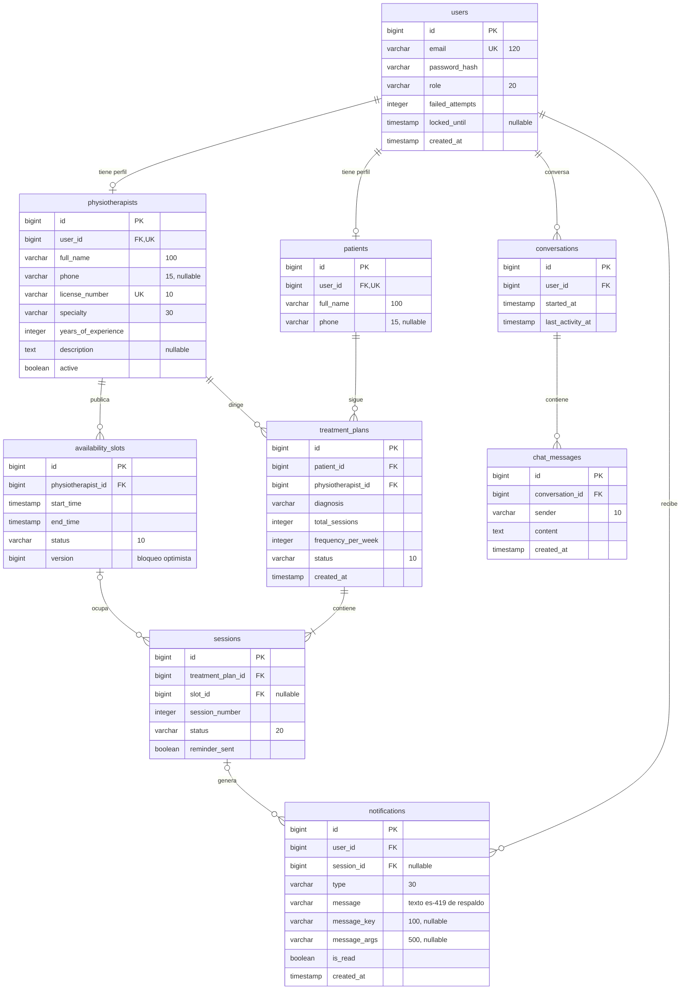

# Modelo de base de datos (PostgreSQL, generado por JPA)

Tablas tal como las crea Hibernate a partir de las entidades. No existe la tabla `clinical_notes`:
el historial de citas (US14–US16) se consulta sobre `sessions` + `treatment_plans`.

## Explicación

Cada entidad del diagrama de clases se convierte en una tabla con clave primaria autoincremental. Las
relaciones se implementan con claves foráneas: `patients` y `physiotherapists` apuntan a `users` (relación uno
a uno, garantizada con `UNIQUE`), `treatment_plans` une a un paciente con un fisioterapeuta, `sessions`
pertenece a un plan y ocupa un bloque de `availability_slots`, `notifications` se dirige a un usuario, y
`conversations` (con sus `chat_messages`) guarda el historial del asistente de cada usuario (US17–US20). Las
restricciones `UNIQUE` en `email` y `license_number` impiden cuentas y colegiaturas duplicadas, y la columna
`version` permite el bloqueo optimista de la reserva (US10).
