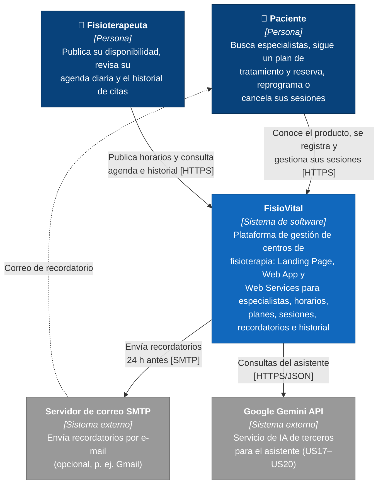

# C4 · Nivel 1 — Diagrama de Contexto

**Leyenda:** azul oscuro = persona · azul = sistema en alcance · gris = sistema externo.

## Explicación

El diagrama muestra a **FisioVital como una caja negra** y delimita qué queda dentro y fuera del sistema.
Sus dos actores son el **paciente**, que busca especialistas por especialidad, sigue un plan de tratamiento
y reserva, reprograma o cancela sesiones, y el **fisioterapeuta**, que publica bloques de disponibilidad y
consulta su agenda diaria y el historial de citas de sus pacientes. Fuera del sistema están el **servidor
SMTP**, que se usa de forma opcional para enviar por correo los recordatorios 24 horas antes de cada sesión,
y la **API de Google Gemini**, el servicio de IA de terceros con el que el asistente resuelve dudas, recomienda
especialistas y reserva o reprograma sesiones (US17–US20).
