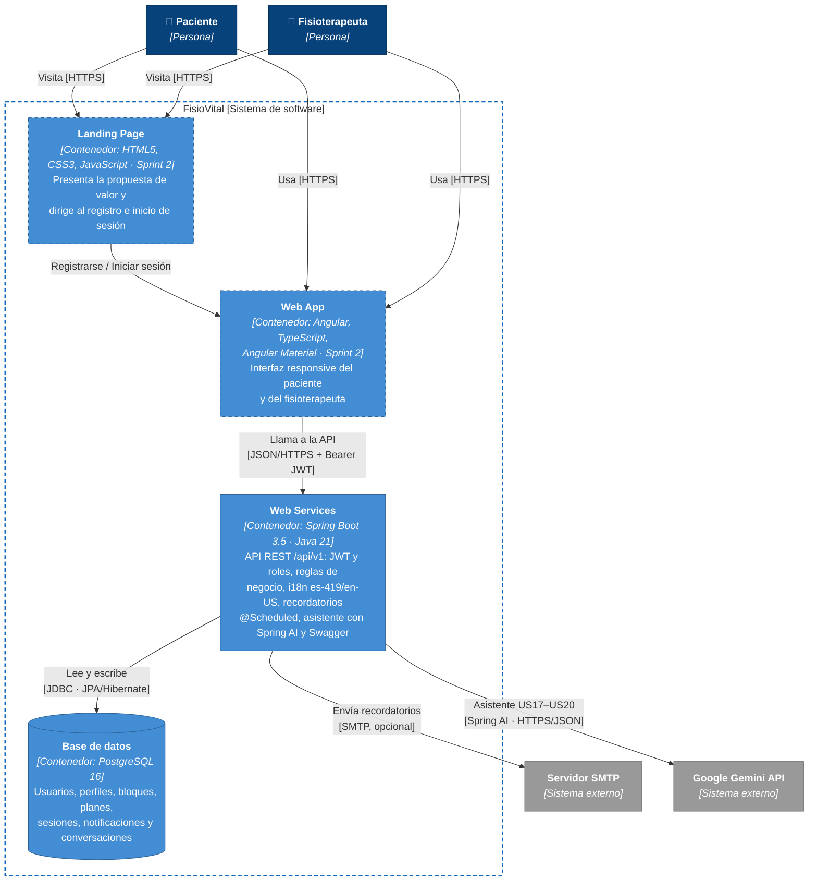

# C4 · Nivel 2 — Diagrama de Contenedores

**Leyenda:** azul oscuro = persona · azul claro = contenedor · gris = sistema externo ·
borde punteado = planificado (Landing Page y Web App en el Sprint 2).

## Explicación

FisioVital se compone de cuatro contenedores. El **Landing Page** (HTML5, CSS3 y JavaScript) presenta el
producto y lleva al registro, y la **Web App** en Angular con Angular Material es la interfaz responsive
donde pacientes y fisioterapeutas trabajan a diario; ambos se construyen en el Sprint 2 (TB3). Los
**Web Services** en Spring Boot exponen la API REST `/api/v1`, protegida con Spring Security y JWT por roles,
concentran las reglas de negocio (reserva con control de concurrencia, regla de 24 horas, recordatorios
programados) y responden en español e inglés. La **base de datos PostgreSQL** guarda la información mediante
Spring Data JPA. Como servicios externos, el backend usa un servidor **SMTP** (Gmail) para los recordatorios y
la **API de Gemini** mediante Spring AI para el asistente conversacional (US17–US20). Web Services y
PostgreSQL se levantan juntos con Docker Compose.
