# C4 · Nivel 3 — Diagrama de Componentes (Web Services)

Componentes del contenedor **Web Services** (Spring Boot 3.5 / Java 21). El código sigue una **arquitectura en
capas**, con una sola carpeta por capa: `controller/`, `service/`, `mapper/`, `repository/`, `model/` y `dto/` (`request/` y `response/`)
(además de `security/`, `config/` y `exception/`). En el diagrama los componentes se agrupan por módulo funcional
solo para leerlo mejor; en el código un módulo es el prefijo de sus clases (`Auth*`, `Session*`, …).
Flujo de cada petición: Controller (`controller/`) → Service (`service/`, convierte DTO ↔ Entity con el
Mapper de `mapper/`) → Repository (`repository/`) → PostgreSQL.

```mermaid
flowchart TB
    spa["<b>Web App</b><br/><i>[Contenedor: Angular]</i>"]
    db[("<b>Base de datos</b><br/><i>[Contenedor: PostgreSQL 16]</i>")]
    smtp["<b>Servidor SMTP</b><br/><i>[Sistema externo · Gmail]</i>"]
    gemini["<b>Google Gemini API</b><br/><i>[Sistema externo]</i>"]

    spa -- "JSON/HTTPS + Bearer JWT" --> security

    subgraph api["Web Services [Contenedor: Spring Boot 3.5 · Java 21]"]
        security["<b>Security / JWT</b><br/><i>[Spring Security]</i><br/>JwtAuthenticationFilter, JwtService,<br/>roles PATIENT / PHYSIOTHERAPIST"]
        errors["<b>GlobalExceptionHandler</b><br/><i>[@RestControllerAdvice]</i><br/>Errores i18n 400/401/403/404/405/409/422/503"]

        subgraph iam["Auth* · US01–US03"]
            authCtrl["AuthController"] --> authSvc["AuthService"] --> userRepo[("UserRepository")]
        end

        subgraph profiles["Physiotherapist* / Patient* · US04–US05"]
            physioCtrl["PhysiotherapistController"] --> searchSvc["PhysiotherapistSearchService"]
            lookupSvc["ProfileLookupService"]
            profileRepo[("PatientRepository<br/>PhysiotherapistRepository")]
            searchSvc --> profileRepo
            lookupSvc --> profileRepo
        end

        subgraph scheduling["Availability* / Slot* · US06–US07"]
            slotsCtrl["MySlotsController"] --> availSvc["AvailabilityService"] --> slotRepo[("AvailabilitySlotRepository<br/><i>@Version</i>")]
        end

        subgraph treatment["TreatmentPlan* / Session* / Agenda* · US08–US12"]
            planCtrl["TreatmentPlanController"] --> planSvc["TreatmentPlanService"]
            sessionCtrl["SessionController"] --> sessionSvc["SessionService"]
            agendaCtrl["AgendaController"] --> sessionSvc
            treatRepo[("TreatmentPlanRepository<br/>SessionRepository")]
            planSvc --> treatRepo
            sessionSvc --> treatRepo
        end

        subgraph appointments["Appointment* · US14–US16"]
            histCtrl["AppointmentHistoryController"] --> histSvc["AppointmentHistoryService"] --> apptRepo[("AppointmentRepository")]
        end

        subgraph assistant["Assistant* · US17–US20"]
            asstCtrl["AssistantController"] --> asstSvc["AssistantService<br/><i>Spring AI ChatClient</i>"]
            guard["AssistantGuardrails<br/><i>respuestas de seguridad</i>"]
            asstTools["AssistantTools<br/><i>@Tool: buscar, reservar, reprogramar</i>"]
            convRepo[("ConversationRepository<br/>ChatMessageRepository")]
            asstSvc --> guard
            asstSvc --> convRepo
        end

        subgraph notifications["Notification* · US13"]
            notifCtrl["NotificationController"] --> notifSvc["NotificationService"] --> notifRepo[("NotificationRepository")]
            scheduler["<b>ReminderScheduler</b><br/><i>[@Scheduled]</i>"]
        end
    end

    security --> authCtrl & physioCtrl & slotsCtrl & planCtrl & sessionCtrl & agendaCtrl & histCtrl & notifCtrl & asstCtrl

    authSvc --> profileRepo
    physioCtrl -- "US06" --> availSvc
    searchSvc -- "disponibilidad" --> availSvc
    slotsCtrl --> lookupSvc
    planSvc -- "US10 reserva bloque" --> availSvc
    planSvc --> lookupSvc
    sessionSvc --> slotRepo
    sessionSvc --> lookupSvc
    sessionSvc -- "avisa cambios" --> notifSvc
    histSvc --> lookupSvc
    scheduler -- "sesiones próximas" --> treatRepo
    scheduler --> notifSvc
    asstSvc -- "Spring AI [HTTPS/JSON]" --> gemini
    gemini -. "tool calling" .-> asstTools
    asstTools --> searchSvc & planSvc & sessionSvc & availSvc
    scheduler -. "correo" .-> smtp

    userRepo & profileRepo & slotRepo & treatRepo & apptRepo & notifRepo & convRepo -- "JDBC" --> db

    classDef container fill:#438dd5,stroke:#2e6295,color:#ffffff
    classDef component fill:#85bbf0,stroke:#5d82a8,color:#000000
    classDef external fill:#999999,stroke:#6b6b6b,color:#ffffff
    class spa,db container
    class security,errors,authCtrl,authSvc,userRepo,physioCtrl,searchSvc,lookupSvc,profileRepo,slotsCtrl,availSvc,slotRepo,planCtrl,planSvc,sessionCtrl,sessionSvc,agendaCtrl,treatRepo,histCtrl,histSvc,apptRepo,notifCtrl,notifSvc,notifRepo,scheduler,asstCtrl,asstSvc,guard,asstTools,convRepo component
    class smtp,gemini external
    style api fill:none,stroke:#438dd5,stroke-width:2px,stroke-dasharray:6 4
```

**Leyenda:** azul claro = componente · azul = contenedor · gris = sistema externo ·
cilindro = repositorio JPA o base de datos.

## Explicación

El contenedor Web Services sigue una **arquitectura en capas**. El **controller** recibe un `*RequestDTO`, no tiene
lógica y delega en el **service**. El service concentra las reglas de negocio y usa su **mapper** (MapStruct) para
convertir `RequestDTO → Entity` y `Entity → ResponseDTO`. El **repository** (`JpaRepository`) accede a PostgreSQL
con las entidades de `model/`. Ningún controller usa repositorios ni mappers, y la API nunca devuelve entidades,
solo `*ResponseDTO`. Las peticiones pasan primero por **Security/JWT**, que valida el token y el rol, y cualquier
error termina en el **GlobalExceptionHandler**, que responde con el código HTTP adecuado y un mensaje i18n. El
**ReminderScheduler** se ejecuta solo cada cierto intervalo para crear los recordatorios de US13. En el módulo `Assistant*`,
el **AssistantService** aplica primero las respuestas fijas de seguridad (**AssistantGuardrails**) y luego consulta a
Gemini con Spring AI; cuando el paciente quiere reservar o reprogramar, Gemini invoca las **AssistantTools**, que
reutilizan los services existentes y respetan las mismas reglas de negocio.
