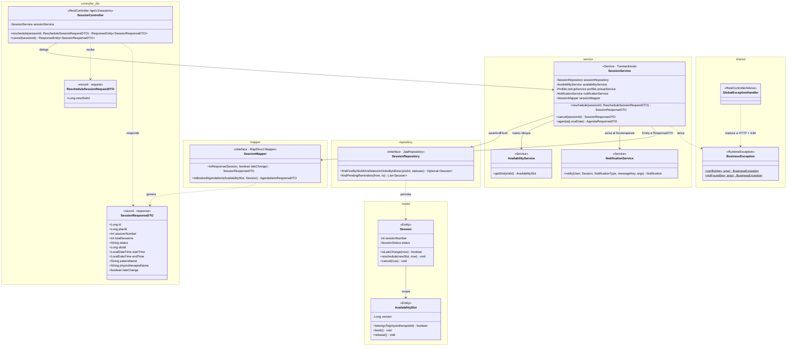

# C4 · Nivel 4 — Diagrama de Código (componente Sesiones, US11–US12)

Detalle de clases de un componente: **reprogramar y cancelar una sesión**. Muestra cómo cada capa
(controller → service → repository, con records `*RequestDTO` / `*ResponseDTO` y un Mapper de MapStruct) se implementa en el código real.
El modelo de dominio completo está en [clases.md](clases.md).

## Secuencia de US11 (reprogramar)

1. `SessionController.reschedule` recibe `RescheduleSessionRequestDTO` y delega en `SessionService`.
2. `SessionService` verifica que la sesión sea del paciente autenticado y obtiene el nuevo bloque con
   `AvailabilityService.getSlot`. Si no es del mismo fisioterapeuta, no está libre o ya pasó, lanza
   `BusinessException.conflict` → **409** con mensaje i18n.
3. `Session.reschedule(newSlot, now)` valida que la sesión siga reservada y sea futura (si no, **422**),
   reserva el nuevo bloque y libera el anterior; `isLateChange(now)` marca el cambio tardío si faltan
   menos de 24 h.
4. `SessionRepository.saveAndFlush` guarda; si otro paciente tomó el bloque, `@Version` provoca
   un conflicto de concurrencia → **409**.
5. `NotificationService.notify` avisa al fisioterapeuta y `SessionMapper` (generado por MapStruct) convierte la
   entidad `Session` en `SessionResponseDTO` con `lateChange`.
