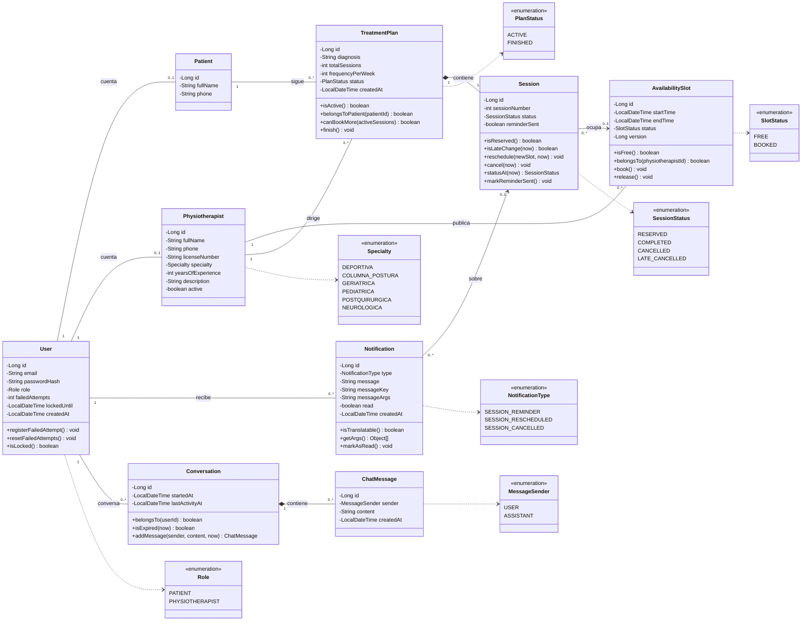

# Diagrama de clases del dominio (Sprint 1)

Entidades JPA reales de `model/`, sin `ClinicalNote` (no corresponde a ninguna historia).
US14–US16 (historial de citas) se resuelven sobre `Session`, sin entidad propia.

## Explicación

El dominio tiene nueve entidades. `User` guarda la cuenta y el rol, y se asocia a un perfil de
`Patient` o de `Physiotherapist`. El fisioterapeuta publica `AvailabilitySlot` (bloques de 60 minutos con
`@Version` para evitar dobles reservas), y paciente y fisioterapeuta se vinculan mediante un `TreatmentPlan`
que contiene sus `Session`; cada sesión ocupa un bloque. `Notification` registra recordatorios y avisos de
cambios, y `Conversation` con sus `ChatMessage` guarda el contexto del asistente con IA (US17–US20). Las reglas de negocio están dentro de las entidades (por ejemplo, `Session.isLateChange` aplica la
regla de 24 horas).

## Trazabilidad con las historias

| Clase | Historias | Regla de negocio |
|---|---|---|
| `User` | US01–US03 | Registro, login con JWT y bloqueo tras 5 intentos fallidos |
| `Physiotherapist` | US02, US04–US05 | Búsqueda por especialidad, ordenada por años de experiencia |
| `AvailabilitySlot` | US06–US07, US10 | Bloques de 60 min sin cruces; `@Version` evita la doble reserva |
| `TreatmentPlan` | US09–US10 | Un solo plan activo por especialista; no admite 0 sesiones |
| `Session` | US08, US10–US12, US14–US16 | Reservar, reprogramar y cancelar; cambio tardío si faltan menos de 24 h |
| `Notification` | US13 | Recordatorio automático (`@Scheduled`), por correo y en la plataforma, y avisos de cambios |
| `Conversation` | US17–US20 | Contexto del asistente; vence tras 30 minutos sin actividad (`isExpired`) |
| `ChatMessage` | US17–US20 | Mensajes del usuario y del asistente; permiten responder "el segundo" sin repetir la fecha (US19) |
